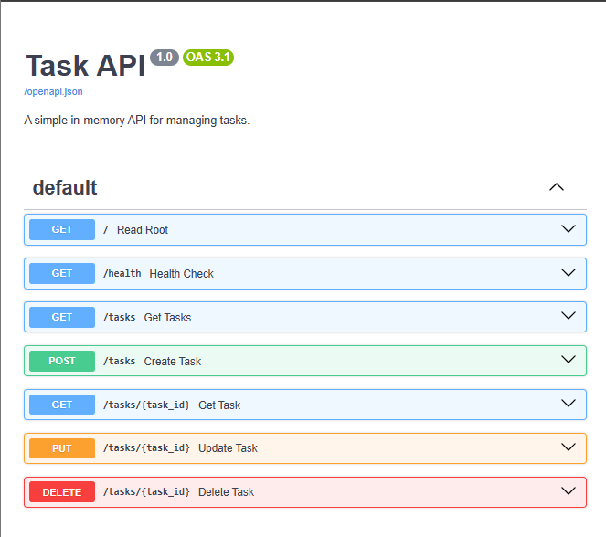

# FlyRank Backend AI Engineering Internship

My learning and implementation journey through the **FlyRank Backend AI Engineering track**.

This repository contains hands-on assignments, implementation notes, API development exercises, and eventually the track capstone.

## Assignment 01 — Build Your First CRUD API

**Code:** BE-01  
**Week:** 02 — Foundations  
**Status:** Completed (pending final submission review)

### Overview

A simple Task Management REST API built using Python and FastAPI.

The API supports the four fundamental CRUD operations:

- Create tasks
- Read all tasks and individual tasks
- Update existing tasks
- Delete tasks

Task data is stored in an in-memory Python list. No database is used in this assignment.

### Tech Stack

- Python
- FastAPI
- Uvicorn
- Swagger UI / OpenAPI
- Git and GitHub

### Project Structure

```text
flyrank-backend-ai-internship/
│
├── README.md
├── .gitignore
├── requirements.txt
│
├── assignments/
│   └── week-02-foundations/
│       └── BE-01-crud-api/
│           ├── main.py
│           └── screenshots/
│               └── swagger-ui.png
│
├── notes/
└── capstone/
```

### Getting Started

**1. Clone the repository**

```bash
git clone https://github.com/ParthBhuptani/flyrank-backend-ai-internship
cd flyrank-backend-ai-internship
```

**2. Create and activate a virtual environment**

Windows CMD:

```cmd
py -m venv .venv
.venv\Scripts\activate
```

macOS / Linux:

```bash
python3 -m venv .venv
source .venv/bin/activate
```

**3. Install dependencies**

```bash
python -m pip install -r requirements.txt
```

**4. Run the API**

From the repository root:

```bash
python -m uvicorn main:app --app-dir assignments/week-02-foundations/BE-01-crud-api --reload
```

The API will be available at:

- API root: http://localhost:8000/
- Health check: http://localhost:8000/health
- Swagger UI: http://localhost:8000/docs
- OpenAPI specification: http://localhost:8000/openapi.json

### API Endpoints

| Method | Endpoint | Description | Success Status |
|---|---|---|---|
| GET | `/` | API information | 200 |
| GET | `/health` | Health check | 200 |
| GET | `/tasks` | Retrieve all tasks | 200 |
| GET | `/tasks/{task_id}` | Retrieve a task by ID | 200 |
| POST | `/tasks` | Create a new task | 201 |
| PUT | `/tasks/{task_id}` | Update a task | 200 |
| DELETE | `/tasks/{task_id}` | Delete a task | 204 |

### Task Data Model

Each task contains:

```json
{
  "id": 1,
  "title": "Learn FastAPI",
  "done": false
}
```

### Validation and Error Handling

The API handles the following cases:

| Scenario | HTTP Status |
|---|---|
| Successful read or update | 200 |
| Successful task creation | 201 |
| Successful deletion | 204 |
| Missing or invalid task input | 400 |
| Task ID does not exist | 404 |

Error responses use JSON messages to explain what went wrong.

### Example API Test

Command:

```bash
curl -i http://localhost:8000/health
```

**Actual terminal response:**

[Replace this line with the complete output copied from your own curl command, including HTTP status and JSON response.]

### Swagger UI

Interactive API documentation generated automatically by FastAPI using OpenAPI.



### Key Concepts Learned

- HTTP methods and the request-response lifecycle
- REST API fundamentals
- CRUD operations
- FastAPI routing and path parameters
- Request body handling and input validation
- HTTP status codes and error handling
- In-memory data storage
- API documentation using Swagger UI
- Git version control and GitHub publishing

### Important Note

This assignment uses in-memory storage. Tasks are reset to their initial state when the server restarts. Persistent database storage is outside the scope of this assignment.

---

More assignments, implementation notes, and the Backend AI Engineering capstone will be documented here as the internship progresses.